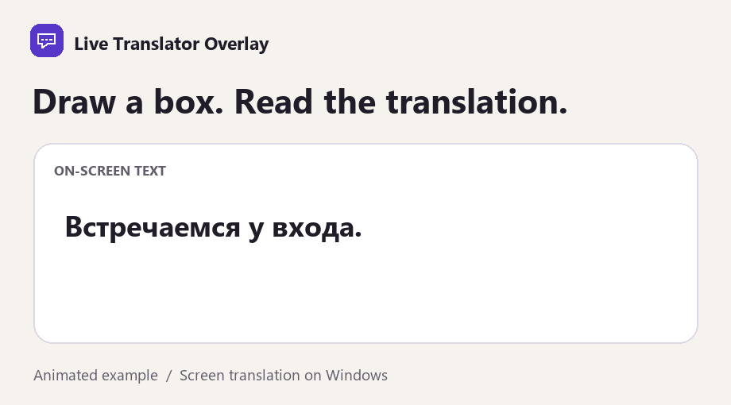

# Live Translator Overlay

<p align="center">
  
  
  
  
</p>

<p align="center">
  <strong>Open-source, local-first real-time speech translation and screen OCR overlay for Windows and macOS.</strong><br>
  Translate live system audio, microphone speech, and on-screen text with zero telemetry and full MIT-licensed source code.
</p>

<p align="center">
  
</p>

---

## Overview

Live Translator Overlay is an open-source project licensed under the [MIT License](LICENSE). The entire application source code—including the 1.x release line and all subsequent versions—is free and open source.

By default, speech recognition runs locally on the CPU with no GPU, Python environment, or API key required. On first audio use, the app downloads and SHA-256-verifies the multilingual Whisper model (`148 MB` balanced default or `488 MB` larger optional model) and Silero VAD (`0.9 MB`), then caches them locally for offline speech recognition. Default text translation uses Google Translate without a key (internet connection and service limits apply). Optional cloud providers (Groq AI and Deepgram) and an optional separately prepared offline translator (`runtime/translation_worker.py`) are also supported.

---

## Features

### Windows (`LiveTranslatorOverlay`)
- **Local Multilingual CPU Speech (Default, No Key)**: Uses Whisper.net 1.9.1 (`ggml-base.bin` default or `ggml-small.bin` optional) with Silero VAD v6.2.0 and automatic SHA-256 verification, including a `NoAvx` native fallback for older x64 processors. Supports explicit source language selection or Auto-detect.
- **Key-Free Text Translation + Optional Cloud Engines**: Uses Google Translate by default (with MyMemory fallback), or user-supplied API keys for **Groq AI** (LLM translation and `whisper-large-v3` STT) and **Deepgram** (streaming WebSocket STT with word-level speaker diarization).
- **Optional Local Offline Text Translation**: Supports separately prepared local models via `runtime/translation_worker.py` (M2M100 418M CTranslate2 int8 + OpenCC) and `runtime/speech_worker.py` (`enable-local-speech.ps1`).
- **Live Screen OCR Translation**: Draw any screen bounding rectangle to translate foreign game dialogue, text, or UI labels on-device via `Windows.Media.Ocr`.
- **Privacy-First Floating Overlay**: Always-on-top, draggable captions with adjustable font sizes and Windows Graphics Capture Exclusion (`SetWindowDisplayAffinity` / `WDA_EXCLUDEFROMCAPTURE`) to keep captions and app windows hidden from OBS Studio, Discord, Zoom, and screen capture tools.
- **Japanese & Multi-Script Support**: Renders Japanese captions as Standard, Hiragana, Furigana, Romaji, or Katakana, with 100-language catalog coverage and UI localization in **English**, **Indonesian**, **Russian**, and **Spanish**.
- **Session History & Summarization**: Retains up to 500 session entries with scroll-preserving review, text export, and optional Groq conversation summarization.
- **Windows DPAPI Key Protection & Updates**: Encrypts saved Groq and Deepgram keys with Windows Data Protection (`CurrentUser`), checks the `updates/ml-stable.json` GitHub release feed, and includes an optional bug-report dialog with device status tracking (`reports_status.json`).
- **Community & Usage Tracking**: Tracks personal audio translation time privately on-device, with optional Community rankings (when configured via a local `community.json`) and a voluntary Support development window.

### macOS (`MacApp`, `macOS 14+`)
- **Local CPU Speech & Floating Captions**: Captures **System audio** (`ScreenCaptureKit`) or **Microphone** (`AVAudioEngine`) via `MacApp/NativeAudio.swift` and transcribes locally on CPU with Whisper (`Balanced` / `Larger model`) and Silero VAD.
- **Manual Text Translation & Session History**: Side-by-side translation workspace using Google Translate (with fallback) or a session-only Groq API key, 100-language catalog, up to 500 history entries with clear/export, private audio timer, and Community/Support views.
- **Current macOS limits**: Screen OCR and an automatic Mac updater are not implemented yet. Prebuilt Mac bundles are ad-hoc signed rather than Apple Developer ID notarized; see [MacApp/INSTALL.md](MacApp/INSTALL.md).

### Accuracy & Hardware Caveats
- **Approximation & Latency**: Speech recognition and machine translation are approximate and can omit or alter words, names, or negations. CPU decoding speed depends on your processor; slower machines can fall behind live speech, and upstream key-free translation services can rate-limit or produce inaccurate fallbacks (see [docs/cpu-release-verification.md](docs/cpu-release-verification.md) and [docs/reviews/2026-11-10-russian-live-caption-quality.md](docs/reviews/2026-11-10-russian-live-caption-quality.md)).

---

## Build from Source

### Prerequisites
- [.NET 10 SDK](https://dotnet.microsoft.com/download/dotnet/10.0)
- **Windows builds**: Windows 10/11 x64 (`net10.0-windows10.0.19041.0` target). Self-contained release packaging (`scripts/package-windows.ps1`) also uses Visual Studio C++ CRT redistributable files; installer builds (`scripts/build-setup.ps1`) use NSIS (`makensis.exe`).
- **macOS builds**: macOS 14+ with Xcode Command Line Tools (`swiftc`, `codesign`) for `MacApp/NativeAudio.swift` and `.app` bundling (`MacApp/package-macos.sh`).
- **Optional Supabase check**: Node.js (to run `tests/CommunityDatabase/verify.mjs` against `@electric-sql/pglite` in a scratch folder).

### Windows (WPF App & Offline Checks)

```powershell
dotnet restore LiveTranslatorOverlay.csproj
dotnet build LiveTranslatorOverlay.csproj -c Release --nologo
dotnet run --project LiveTranslatorOverlay.csproj -c Release --nologo
```

Run the deterministic offline test suites on Windows:

```powershell
dotnet run --project tests/RegressionChecks/RegressionChecks.csproj -c Release --nologo
dotnet run --project tests/AuditChecks/AuditChecks.csproj -c Release --nologo
dotnet run --project tests/SpeakerChecks/SpeakerChecks.csproj -c Release --nologo
dotnet run --project tests/LocalCpuChecks/LocalCpuChecks.csproj -c Release --nologo
```

Create a self-contained Windows x64 package (copies CRT DLLs and verifies empty `appsettings.json` credentials):

```powershell
./scripts/package-windows.ps1
```

### macOS (`MacApp`)

```sh
dotnet build MacApp/LiveTranslatorMac.csproj -c Release --nologo
dotnet run --project MacApp/LiveTranslatorMac.csproj -c Release
```

Package and smoke-test a self-contained `.app` bundle on macOS (`osx-arm64` or `osx-x64`):

```sh
bash MacApp/package-macos.sh osx-arm64 ./out
```

### Cross-Platform Shared Library & Community SQL Tests

```sh
dotnet build Shared/LiveTranslatorOverlay.Shared.csproj -c Release --nologo
```

Offline database migration check (see [supabase/README.md](supabase/README.md)):

```sh
npm install --prefix /tmp/pglite @electric-sql/pglite
node tests/CommunityDatabase/verify.mjs /tmp/pglite
```

---

## Downloads

Prebuilt binaries are published on [GitHub Releases](https://github.com/nnavyy/LiveTranslatorOverlay/releases):
- **Windows 10/11 x64**: Self-contained ZIP (`LiveTranslatorOverlay-Windows-x64.zip`) including the .NET runtime and Visual C++ CRT files.
- **macOS 14+ (Apple Silicon `osx-arm64` & Intel `osx-x64`)**: Preview ZIP archives (`LiveTranslatorOverlay-Mac-preview-*.zip`). See [MacApp/INSTALL.md](MacApp/INSTALL.md) for opening ad-hoc signed builds.

---

## Configuration and Privacy

- **Optional API Keys**: Enter Groq or Deepgram keys under **Settings** if using cloud engines. On Windows, keys persist encrypted with DPAPI in `%LOCALAPPDATA%\LiveTranslatorOverlay\appsettings.json` (never commit `appsettings.json`; see [appsettings.example.json](appsettings.example.json)). On macOS, the optional Groq key stays in session memory only.
- **Local-First Processing**: Audio buffers and screen captures stay in volatile memory and are never written to disk or sent to developer servers.
- **Zero Telemetry & Optional Staging Community**: No background analytics or telemetry are collected. Online Community rankings are inactive unless a local `community.json` pointing to a staging Supabase project with a publishable key is placed in the app data directory (see [supabase/README.md](supabase/README.md)).

---

## Support Development

**All features are free; the source code is licensed under MIT; support is voluntary and never unlocks the software or source.**

The in-app **Support development** tab lists the project's planned voluntary tiers:

| Tier | Amount | What it represents |
| --- | --- | --- |
| **Lifetime Supporter** | US$19.99 once | Voluntary lifetime support with a Supporter medal and a personal thank-you. |
| **Lifetime Insider** | US$100 once | Voluntary lifetime support with an Insider medal, release archive, early-access / beta builds, compatible experimental models, priority support, and a personal thank-you. |
| **Donate** | Any positive amount | Voluntary one-time contribution supporting development, testing, and releases (does not grant a paid tier). |

The two lifetime options are independent.

**Current status:** Purchases, public account registration, and donations are **currently closed/disabled** in this release (`SupportCatalog.Closed`). Only a staging-only developer-assisted request preview exists behind a local `community.json` configuration (`previewManualRequests: true`), and it takes no payment.

---

## Documentation & Policies

- **Source License**: [LICENSE](LICENSE) (MIT License)
- **Terms of Service & Open Source Summary**: [APP_LICENSE.md](APP_LICENSE.md)
- **Privacy Policy**: [PRIVACY.md](PRIVACY.md)
- **Third-Party Notices**: [THIRD_PARTY_NOTICES.md](THIRD_PARTY_NOTICES.md)
- **Contributing**: [CONTRIBUTING.md](CONTRIBUTING.md)
- **Security Policy**: [SECURITY.md](SECURITY.md)
- **Code of Conduct**: [CODE_OF_CONDUCT.md](CODE_OF_CONDUCT.md)
- **Release Notes**: [RELEASE_NOTES.md](RELEASE_NOTES.md) · [MacApp/RELEASE_NOTES.md](MacApp/RELEASE_NOTES.md)
