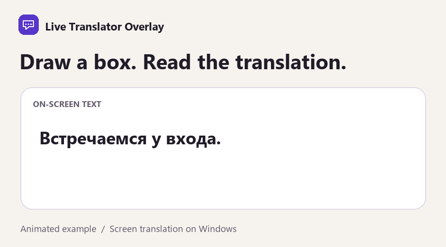

# Live Translator Overlay

<p align="center">
  
  
  
  
  
</p>

<p align="center">
  <strong>Open-source, cross-vendor GPU & CPU real-time speech translation and screen OCR overlay for Windows and macOS.</strong><br>
  Translate live system audio, microphone speech, and on-screen text with zero telemetry, no NVIDIA lock-in, and full MIT-licensed source code.
</p>

<p align="center">
  
</p>

---

## Overview

Live Translator Overlay is an open-source project licensed under the [MIT License](LICENSE). All core translation, OCR, and speech recognition features are free under MIT.

With **v1.1.4**, speech decoding and local translation run substantially faster with zero fansub watermark hallucinations (`Subtitle by DimaTorzok`, `Amara.org`, etc.) alongside the branded Windows Setup wizard (`.exe`), clean Zinc UI, User Profile & Community Rankings, and owner-only Dashboard (`--developer`):
- **Universal Cross-Vendor GPU Acceleration (No CUDA / Python Needed for ASR)**: Uses `Whisper.net.Runtime.Vulkan` (with FlashAttention enabled and safe fallback) on Windows across NVIDIA, AMD, and Intel GPUs, plus `Whisper.net.Runtime.Metal` on Apple Silicon macOS to run **Whisper `large-v3-turbo` (`Q5_0`, `574 MB`)** or fall back to CPU (`ggml-base.bin` / `NoAvx`).
- **VAD-Trimmed, Decoupled Local Agreement-2 Streaming (`250 ms` GPU / `400 ms` CPU)**: All local tiers stream incrementally, trim silence spans from Silero VAD before decoding, reject high `no_speech_prob` / fansub watermark outputs, and run translation asynchronously in a latest-wins background worker so MT never blocks ASR.
- **Persistent Warm Local Translation (`--daemon` + CUDA Auto-Discovery)**: Optionally run offline M2M-100 (`418M` `int8` / `int8_float16`) via `runtime/translation_worker.py --daemon` with automatic CUDA `cublas64_12` discovery (cutting warm MT latency to `337.3 ms` mean / `297.8 ms` P50 on RTX 2050) or multi-threaded `int8` CPU fallback, plus default key-free Google Translate with bounded caching.
- **Empirical Research & Novelty Paper**: See **[research/speech/paper/PAPER_NOVELTY_AND_RESEARCH_GAP.md](research/speech/paper/PAPER_NOVELTY_AND_RESEARCH_GAP.md)** for our full comparative study explaining why consumer Whisper `small` fine-tuning hits a `~10.6%` plateau and documenting measured v1.1.0 Vulkan vs. CPU latency & accuracy benchmarks (`5.00%` RU WER, `4.92%` JA CER, `0.186x` final RTF).

---

## Features

### Windows (`LiveTranslatorOverlay`)
- **Cross-Vendor GPU + CPU Local Speech (`No Key`)**:
  - `local`: `ggml-base.bin` (`148 MB`) on CPU (`Cpu` + `NoAvx` fallback).
  - `local-small`: `ggml-small.bin` (`488 MB`) on CPU.
  - `local-auto` *(new)*: Word-by-word `300 ms` Local Agreement-2 streaming — automatically selects `ggml-large-v3-turbo-q5_0.bin` (`574 MB`) on Vulkan GPU when available, or `ggml-base.bin` on CPU, with Silero VAD v6.2.0 noise gating and startup shader warmup.
  - `local-turbo` *(new)*: Word-by-word streaming using `ggml-large-v3-turbo-q5_0.bin` on Vulkan GPU with CPU fallback.
- **Key-Free & Optional Offline/Cloud Translation**: Key-free Google Translate (MyMemory fallback) by default; optional persistent offline CTranslate2 daemon (`LocalTranslateProvider`, Win32 `JOB_OBJECT_LIMIT_KILL_ON_JOB_CLOSE` managed); optional user-supplied **Groq AI** and **Deepgram** keys protected via Windows DPAPI (`CurrentUser`).
- **Live Screen OCR Translation**: Draw any screen region to translate game dialogue or UI text locally via `Windows.Media.Ocr`.
- **Privacy-First Floating Overlay**: Draggable always-on-top captions with `WDA_EXCLUDEFROMCAPTURE` capture exclusion for OBS/Discord/Zoom.
- **Japanese & Multi-Script Rendering + 4 UI Languages**: Standard, Hiragana, Furigana, Romaji, or Katakana output across a 100-language catalog, localized in English, Indonesian, Russian, and Spanish.
- **One-Click Windows Setup Wizard & Authenticated Update Channels (`main` / private `beta` / owner `dev`)**: Verifies SHA-256 package hashes across `updates/ml-stable.json` (`main`), server-gated private Supabase Storage signed URLs (`beta`, requiring a developer-verified `US$100` Lifetime Insider grant), and local `DevFeed\ml-dev.json` (`dev`). Windows releases publish both `LiveTranslatorOverlay-Setup-<ver>.exe` (NSIS 1-click installer) and `LiveTranslatorOverlay-Windows-x64.zip`.
- **Login-Optional Donations (`User#XXXXX`), Salted HWID & ECDSA Provenance (`ml-3`)**: Core translation and custom donations work **without login** (appearing deterministically as `User#10000`–`User#99999` on Supporters, protected locally in `guest-donations.dat`). Joining **Community Rankings** or claiming **Lifetime Supporter (`US$19.99`)** / **Lifetime Insider (`US$100`)** badges requires email OTP sign-in (`noreply@livetranslator.app`). Anti-spoofing and device rate limits use a one-way salted SHA-256 hardware fingerprint (`HardwareFingerprint`), ECDSA P-256 entitlements (`EntitlementSignature`), and Supabase RLS (`20261123180000_guest_donations_hwid_and_antiabuse.sql`) without ever transmitting raw serial numbers.
- **Account Login, Selectable Tiers & Donation Tracking**: Built-in **Community & Account** dialog supporting email OTP sign-in (`livetranslator.app` via Supabase Auth when `community.json` is configured, or encrypted local staging ledger offline), guest & signed-in donation history, selectable **Lifetime Supporter (`US$19.99`)**, **Lifetime Insider (`US$100` Beta access)**, or custom `User#XXXXX` donations, and solo-developer gratitude messages. Core MIT functionality remains free and public checkout remains staged (`SupportCatalog.Closed`).

### macOS (`MacApp`, `macOS 14+`)
- **Metal GPU / CPU Local Speech & Floating Captions**: Captures **System audio** (`ScreenCaptureKit`) or **Microphone** (`AVAudioEngine`) via `MacApp/NativeAudio.swift` with selectable `Balanced (CPU)`, `Larger model (CPU)`, `Auto (Metal GPU / CPU)`, and `Large-v3-turbo (Metal GPU)` speech options.
- **Side-by-Side Workspace, History & Community/Account**: 100-language catalog, up to 500 scroll-preserving history entries, and synchronized Account Login, Donation Tracker, and Update Channel selector.
- **Current macOS limits**: Screen OCR and automatic in-app self-updater remain Windows-only; prebuilt Mac archives are ad-hoc signed ([MacApp/INSTALL.md](MacApp/INSTALL.md)).

### Accuracy & Latency Notes
- Speech recognition and translation remain approximate. On an RTX 2050 laptop running cross-vendor Vulkan (`Q5_0`), `v1.1.4` averages `536.1 ms` per ASR streaming step (`919.6 ms` P95, `501.7 ms` 1st-word compute, `0.101x` final RTF — `9.9x` faster than real time) with `6.42%` mixed held-out FLEURS error (`9.71%` EN, `7.62%` ID, `3.33%` JA CER, `5.00%` RU), and `337.3 ms` warm M2M-100 CUDA translation (`297.8 ms` P50 vs `912.0 ms` P50 CPU baseline; `250 ms` GPU / `400 ms` CPU sliding windows, asynchronous MT worker). True wall-clock time depends on host GPU/CPU speed and selected translation engine.

---

## 3-Branch Release Channels (`dev`, `beta`, `main`)

| Branch / Channel | Repository & Feed | Intended Audience | Notes |
|---|---|---|---|
| **`main` (`stable`)** | Public `origin` (`updates/ml-stable.json`) | Free MIT users & **Lifetime Supporters (`US$19.99`)** | Verified public Windows (`.exe` Setup + `.zip`) & Mac releases. |
| **`beta`** | Private repo `private` + authenticated Supabase Edge Function `beta-release` | **Developer-verified Lifetime Insiders (`US$100`)** | Locked in app until the developer verifies your payment (`lt_admin_grant_support` / `Refresh access status`); downloads via time-limited signed Storage URLs. |
| **`dev`** | Owner local workspace (`DevFeed\ml-dev.json`) & `private` repo | Repository owner only | Syncs to `%LOCALAPPDATA%\LiveTranslatorOverlay\DevApp` and refreshes desktop/workspace shortcut via `scripts/publish-channel.ps1 -Channel dev`. |

---

## Build from Source

### Prerequisites
- [.NET 10 SDK](https://dotnet.microsoft.com/download/dotnet/10.0)
- **Windows builds**: Windows 10/11 x64. Packaging (`scripts/package-windows.ps1`) bundles C++ CRT DLLs (VS Redistributable or `System32` fallback) alongside Vulkan and CPU/NoAvx native runtimes.
- **macOS builds**: macOS 14+ with Xcode Command Line Tools (`swiftc`, `codesign`) for `MacApp/package-macos.sh`.
- **Database checks**: Node.js (`@electric-sql/pglite` in an external temp dir).

### Build & Verify

```powershell
# Build Windows & macOS targets
dotnet build LiveTranslatorOverlay.csproj -c Release --nologo
dotnet build MacApp/LiveTranslatorMac.csproj -c Release --nologo

# Run all 4 offline verification suites + WPF UI check
dotnet run --project tests/RegressionChecks/RegressionChecks.csproj -c Release --nologo
dotnet run --project tests/AuditChecks/AuditChecks.csproj -c Release --nologo
dotnet run --project tests/SpeakerChecks/SpeakerChecks.csproj -c Release --nologo
dotnet run --project tests/LocalCpuChecks/LocalCpuChecks.csproj -c Release --nologo
dotnet run --project tests/LocalCpuChecks/LocalCpuChecks.csproj -c Release --nologo -- --ui

# Package self-contained Windows release or sync owner DevApp
./scripts/package-windows.ps1
./scripts/publish-channel.ps1 -Channel dev
```

Offline database migration check (see [supabase/README.md](supabase/README.md)):

```powershell
npm.cmd install --prefix "$env:TEMP\pglite-verify" @electric-sql/pglite
node tests/CommunityDatabase/verify.mjs "$env:TEMP\pglite-verify\node_modules"
```

---

## Downloads & Configuration

Prebuilt binaries are published on [GitHub Releases](https://github.com/nnavyy/LiveTranslatorOverlay/releases):
- **Windows 10/11 x64 Setup Wizard (Recommended)**: `LiveTranslatorOverlay-Setup-1.1.4.exe` (one-click per-user installer — extracts binaries, installs Start Menu & Desktop shortcuts, and prepares speech models).
- **Windows 10/11 x64 Portable Archive**: `LiveTranslatorOverlay-Windows-x64.zip` (self-contained .NET + CRT + Vulkan + CPU/NoAvx).
- **macOS 14+ (`osx-arm64` / `osx-x64`)**: `LiveTranslatorOverlay-Mac-preview-*.zip` (Metal + CPU).

Optional keys persist under `%LOCALAPPDATA%\LiveTranslatorOverlay\appsettings.json` (DPAPI encrypted on Windows; never commit `appsettings.json` or `community.json`).

---

## Support Development

**All core features remain free under the [MIT License](LICENSE). Voluntary support funds ongoing solo development across additional languages and Windows/macOS builds.**

| Tier | Login Required? | Amount | Benefits & Notes |
|---|---|---|---|
| **Lifetime Supporter** | **Yes (Email OTP)** | `US$19.99` once | Signed lifetime support record & personal thank-you, helping sustain solo multi-language development. |
| **Lifetime Insider** | **Yes (Email OTP)** | `US$100` once | Developer-verified `beta` channel early-access builds, priority support & experimental features. |
| **Custom Donate** | **No (Optional)** | Any positive USD | Appears anonymously as deterministic `User#XXXXX` from your salted HWID on the Supporters board, or links to your signed-in ledger. |

*Note: Real payment gateway links remain disabled (`SupportCatalog.Closed`) while checkout integration is staged; sign-in, `livetranslator.app` SMTP templates (`supabase/email/`), and selection operate via local staging tracking or configured Supabase preview instances.*

---

## Documentation & Policies

- **Academic Paper (Research Gap & Novelty)**: [research/speech/paper/PAPER_NOVELTY_AND_RESEARCH_GAP.md](research/speech/paper/PAPER_NOVELTY_AND_RESEARCH_GAP.md)
- **Source License**: [LICENSE](LICENSE) (MIT License)
- **Terms & Privacy**: [APP_LICENSE.md](APP_LICENSE.md) · [PRIVACY.md](PRIVACY.md) · [THIRD_PARTY_NOTICES.md](THIRD_PARTY_NOTICES.md)
- **Community Database & Migrations**: [supabase/README.md](supabase/README.md)
- **Contributing / Security / Conduct**: [CONTRIBUTING.md](CONTRIBUTING.md) · [SECURITY.md](SECURITY.md) · [CODE_OF_CONDUCT.md](CODE_OF_CONDUCT.md)
- **Release Notes**: [RELEASE_NOTES.md](RELEASE_NOTES.md) · [MacApp/RELEASE_NOTES.md](MacApp/RELEASE_NOTES.md)
